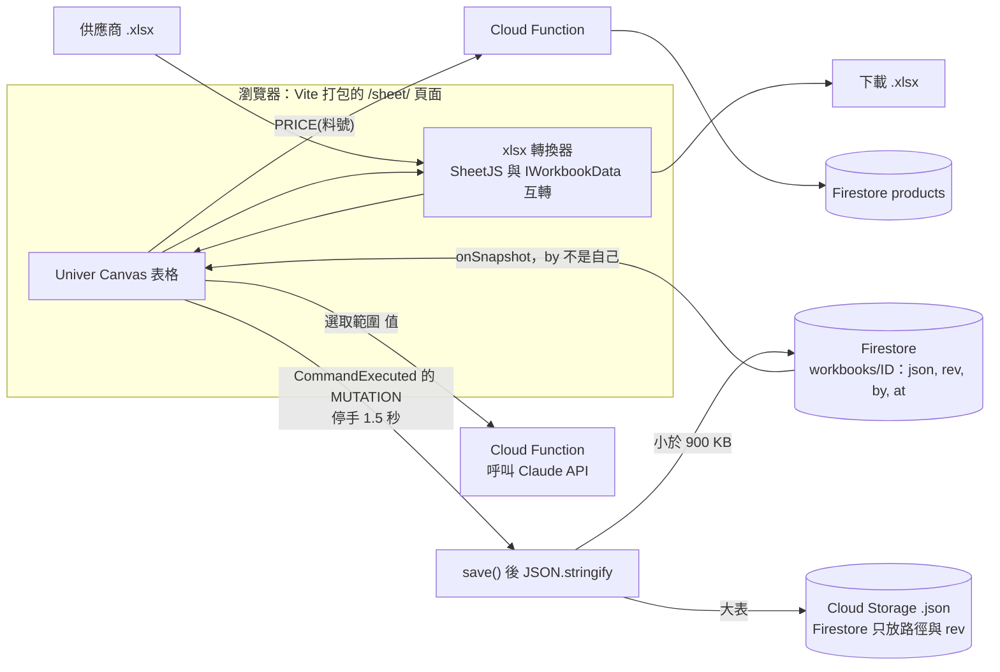
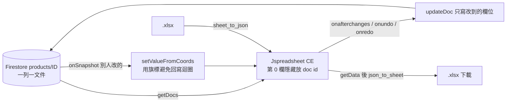
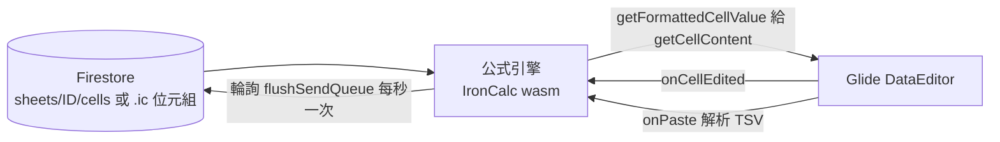
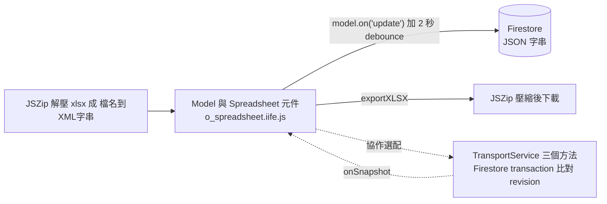

# 自己做網頁版 Excel：A＋B＋C 組合藍圖

> 本文件是「合成文件」：只根據本目錄的 [00-comparison.md](00-comparison.md)、各專案資料包的第 6 節（值得拆出來用的部分）與 [deep-dives/](deep-dives/) 寫成，**沒有重新讀任何原始碼、沒有連網**。
> 資料是 2026-11-04 的快照，星數、授權、程式碼位置、套件版本動手前請重新確認。授權白話整理**不是法律意見**。
> 標「（我的估計）」的人天數、架構建議是本文作者的推論，資料包裡沒有人實際跑過。標「未確認」的是資料包自己也沒驗證的地方。
> 工作量的前提：由你用 Claude Code 開發、熟悉 Firebase、前端是純 JavaScript；含基本測試，不含美術設計與長期維運。

---

## 先講結論：最推薦的路線

你的情況：純 JavaScript 倉儲系統放在 Firebase Hosting、個人／自家營運使用、用 Claude Code 開發、最想要的是「像 Excel 的網頁表格，而且要看得懂、改得動」。

**主推路線：Univer 開源版（畫面＋公式）＋ SheetJS（xlsx 讀寫）＋ Firestore（存 JSON 快照）＋ Cloud Function（呼叫 Claude）。** 這就是比較文件裡的配方 ②。理由：

1. 它是全部資料包裡唯一同時「Apache-2.0 授權乾淨、Canvas 渲染、真正的儲存格 A1 公式（511 個有計算的函數）、有繁中語系、有手機外掛、有條件格式／篩選／排序／資料驗證／凍結／合併」的開源底座（見 [Univer 資料包](dream-num__univer.md) 第 11 節）。
2. 資料模型是一份純 JSON，`save()` 取出、`createWorkbook()` 灌回，接 Firestore 只要幾十行（[architecture 第七節](deep-dives/dream-num__univer__architecture.md)）。
3. 它的缺口（xlsx、協作、圖表、樞紐）正好可以拆開補：xlsx 用 SheetJS、協作先不做、圖表之後掛 ECharts。

**今天就想動手、只是要批次改庫存／成本的話**：先做方案二（Jspreadsheet CE，約 2～3 人天），它不需要打包工具，可以直接放進你現有的純 JS 頁面。兩個方案不衝突：方案二解決「今天的表格」，方案一是「真的 Excel」。

**用一張表決定：**

| 你要的是 | 選 | 理由 |
|---|---|---|
| 商品／庫存／成本的可編輯表格，資料已經在 Firestore | 方案二 Jspreadsheet CE | 免打包、MIT、一列一文件，最小風險 |
| 多工作表、A1 公式、跨表、條件格式、像 Excel 的手感 | **方案一 Univer（主推）** | 唯一授權乾淨又功能完整的 |
| 全部功能都要開源（xlsx、圖表、樞紐、協作）且能接受維運成本 | 方案四 o-spreadsheet | LGPL、功能最全，但 UI 依賴 Owl alpha、沒有繁中 |
| 想自己拼最大彈性、公式正確性優先 | 方案三 Glide＋IronCalc | 工作量最大 |
| 不想自己做，只要好用的後台 | 方案五 Grist／ONLYOFFICE | 不是嵌入元件，是另架一台伺服器 |

**這條路線你必須接受的限制（資料包一致的結論）：**

- 開源版 Univer **沒有 xlsx 匯入匯出**（連 csv 也沒有），而且 SheetJS 免費版**寫不出字型、顏色、框線、凍結窗格、條件格式、資料驗證**。也就是「匯出的 Excel 會是白底素表，只有值、公式字串、數字格式、合併、欄寬」。要漂亮報表請交給 OfficeCLI 之類（見第三節）。
- **沒有即時多人協作**。建議先做「單人編輯＋版本號偵測衝突」（[oss-vs-pro](deep-dives/dream-num__univer__oss-vs-pro.md)）。
- **套件很重**：資料包估 README 建議的 13 個套件 gzip 後約 2.7 MB（由原始碼量級推估，**未建置實測**），建議把它放在獨立頁面 `/sheet/`，不要塞進每個頁面。
- 價格表欄位之類的**主資料仍留在你原本的 Firestore 集合**，試算表是「分析／報價／成本試算」的工作區，不要讓整個倉儲系統綁死在試算表快照上（o-spreadsheet 資料包也是同樣建議）。

**動手前要先確認的事（資料包都標未確認）：** ① `@univerjs/preset-sheets-core/locales/zh-TW` 這個子路徑是否存在（找不到就退回逐套件匯入 `@univerjs/sheets-ui/locale/zh-TW`，該檔確定存在）；② SheetJS 新版從 `cdn.sheetjs.com` 安裝後的版本號與授權（資料包都沒連網驗證）；③ Univer Pro 價格（未確認，且你的路線不需要）。

---

## 方案一覽

| 方案 | 組成 | MVP 人天 | 完整人天 | 授權風險 | 一句話 |
|---|---|---|---|---|---|
| 一（主推） | Univer ＋ SheetJS ＋ Firestore | 5～7 | 10～14 | 低 | 真正的網頁 Excel，匯出無樣式 |
| 二（最快） | Jspreadsheet CE ＋ SheetJS ＋ Firestore | 2～3 | 4～6 | 低 | 今天就能放進倉儲系統的批次編輯表 |
| 三 | Glide Data Grid ＋ IronCalc／HyperFormula ＋ SheetJS | 12～20 | 25 以上 | IronCalc 低；HyperFormula 對外要處理 GPL | 自己組，彈性最大、最累 |
| 四 | o-spreadsheet（全套） ＋ JSZip ＋ Firestore | 4～6 | 9～12（含協作） | 低（別改原檔） | 全開源功能最全，但 Owl alpha、無繁中 |
| 五 | 自架 Grist 或 ONLYOFFICE | 3～5 | 5～8 | Grist 低；ONLYOFFICE 為 AGPL 加附加條款 | 不用自己做，但要多一台伺服器 |

人天都是「我的估計」，各資料包沒有給工時。

### 方案一：Univer ＋ SheetJS ＋ Firestore（主推）

**組成**

- 畫面＋公式：[Univer](dream-num__univer.md)，用 [preset-sheets-core](https://github.com/dream-num/univer/blob/c13b042d18c80c8348fbe52da445d68435febbca/presets/packages/preset-sheets-core/src/preset.ts) 或 Plugin 模式（[architecture 5-2 的 13 套件清單](deep-dives/dream-num__univer__architecture.md)）。**只裝 `@univerjs/*` 開源套件**，不要裝 `@univerjs-pro/*`，也別碰 `@univerjs/preset-sheets-advanced`／`-collaboration`（名稱掛開源前綴，實際是 Pro，見 [oss-vs-pro](deep-dives/dream-num__univer__oss-vs-pro.md) 1-4）。
- xlsx 讀寫：[SheetJS](SheetJS__sheetjs.md)，橋接寫法照 [xlsxspread.js 的 stox／xtos](https://github.com/SheetJS/sheetjs/blob/515d1c6f2e1d3ca422ee9198b177cfd926434936/demos/xspreadsheet/xlsxspread.js)（133 行，記得修第 100 行的 `Boolean("false")` bug）。
- 資料模型：[IWorkbookData 型別](https://github.com/dream-num/univer/blob/c13b042d18c80c8348fbe52da445d68435febbca/packages/core/src/sheets/typedef.ts#L32-L342)（`cellData[列][欄] = { v, t, f, s }`）。
- 存檔：`fWorkbook.save()`（[f-workbook.ts](https://github.com/dream-num/univer/blob/c13b042d18c80c8348fbe52da445d68435febbca/packages/sheets/src/facade/f-workbook.ts#L182)）。
- Claude：Cloud Function 轉呼叫 Claude API，工具定義與系統提示詞抄 [GenOffice 的 ai/tools.ts](https://github.com/genspark-ai/genoffice/blob/4b55db9ed1994575a695160ffc6cfd0bfc866211/apps/sheets/src/renderer/ai/tools.ts) 與 [prompts/base.md](https://github.com/genspark-ai/genoffice/blob/4b55db9ed1994575a695160ffc6cfd0bfc866211/apps/sheets/src/renderer/ai/prompts/base.md)。

**架構與資料流**



Firestore 細節（出自 [architecture 7-2](deep-dives/dream-num__univer__architecture.md)，並加上我的 `rev` 衝突偵測建議）：

1. 整本快照存成**一個 JSON 字串欄位**（避開 Firestore 不能陣列套陣列、不接受 `undefined`）；欄位 `{ json, rev, by, at }`。
2. 寫入前用 `runTransaction` 比對 `rev`，不同就提示「別台裝置已更新」，不要硬蓋。
3. 單一文件 1 MiB 上限（Firebase 規則，非 repo 內容）；中文一字約 3 bytes，超過約 900 KB 改存 Cloud Storage，或一張工作表一份文件。
4. `by` 欄位辨識自己的寫入，收到別台的更新就 `disposeUnit` 後整本重載（游標與復原堆疊會重置）。
5. 安全規則至少限制 `request.auth.uid` 為你本人。

**要自己寫的部分**：Vite 專案與 Facade 匯入順序；Firestore 存取層；xlsx ⇄ `IWorkbookData` 雙向轉換器（最大一塊）；`PRICE()` 這類自訂函數；Cloud Function；欄位樣式對照（SheetJS 讀進來只有填色，其餘外觀會掉）。

**工作量（我的估計）**：Vite＋嵌入＋繁中 0.5；Firestore 存取＋rev 1；xlsx 匯入轉換器 2～3；匯出 1～1.5；自訂函數 0.5～1；驗收與修 bug 1～2。MVP 合計 5～7 人天。完整版再加：Claude 側欄 1～2、圖表（ECharts 浮動 DOM）2、手機版 1～2、版本歷史與簡單鎖 2。

**風險**：套件重（未實測）；xlsx 轉換器是自己寫的，保真度取決於你寫了多少；`save()` 只輸出已註冊外掛的資料，所以每個會存檔的頁面外掛組合必須一致；Pro 邊界混淆；Univer 升版 API 會變（文件 `API_STABILITY.md` 仍寫 pre-1.0）。

**授權**：Apache-2.0，可商用可閉源，保留版權與 LICENSE（內嵌 numfmt 為 MIT 也要保留）；SheetJS Apache-2.0，商標不能當產品名。

### 方案二：Jspreadsheet CE ＋ SheetJS ＋ Firestore（最快）

**組成**：[Jspreadsheet CE](jspreadsheet__ce.md)（MIT，`dist/index.js` 約 145 KB、gzip 約 34 KB，另加 jsuites 與公式套件）＋ SheetJS ＋ 你現有的 Firestore。資料包第 11 節已附「從 Firestore 載入商品並逐格存回」範例，約 30 行。



**要自己寫的部分**：隱藏 id 欄與欄位對照；新增列（`oninsertrow` 後 `addDoc`，再把新 id 回填）與刪除列（`onbeforedeleterow` 先記 id）；`onundo`／`onredo` 另外處理（復原不會觸發 `onafterchanges`，[history.js#L190-L196](https://github.com/jspreadsheet/ce/blob/d9c04e8a1acec6b87b0580b79868cd4d2f73599e/src/utils/history.js#L190-L196)）；繁中字典（`setDictionary`，舊鍵名對不上 v5，要自己翻）；金額一律包 `ROUND`（Basic 公式沒處理浮點誤差）；xlsx 轉換（只搬值與公式字串）。

**工作量（我的估計）**：基本表＋Firestore 1；SheetJS 匯入匯出 0.5；新增／刪除／復原／繁中 0.5～1；驗收 0.5。合計 2～3 人天。

**風險**：DOM 渲染，建議數千到一兩萬列（未實測，其餘分頁）；公式引擎 `@jspreadsheet/formula` 原始碼**不在 GitHub**，函數清單無法驗證（外部宣稱 403 個）；沒有跨工作表公式、條件格式、協作、圖表（Pro 才有）。資料量大或要強篩選分組，可改 [AG Grid 社群版](ag-grid__ag-grid.md)（MIT，但貼上多格、拖拉填滿、xlsx 匯出是企業版，放公開網址要買授權）。

**授權**：MIT，保留版權與授權文字。**沒選 Handsontable 的原因**：資料包分析條文後，小生意自家營運算商業用途需買授權，且禁止拿去做競爭的表格產品。

### 方案三：Glide Data Grid ＋ IronCalc（或 HyperFormula）＋ SheetJS

**組成**：畫面用 [Glide Data Grid](glideapps__glide-data-grid.md)（MIT，Canvas，React，無公式）；公式引擎二選一：[IronCalc](ironcalc__IronCalc.md) 的 `@ironcalc/wasm`（MIT／Apache-2.0，497 函數，xlsx 用 `@ironcalc/wasm-xlsx`）或 [HyperFormula](handsontable__hyperformula.md)（355 函數，**GPL 或買授權**）；xlsx 用 SheetJS 或 IronCalc。



**要自己寫的部分**：整個「試算表模型」。引擎只管算，格式（字型、顏色、框線）、合併、凍結、欄寬列高、篩選排序、資料驗證都要自己做或放棄；貼上（Glide 預設只貼一格，要 `onPaste={true}`，且超出列數會被丟掉）；填滿（Glide 只循環複製不遞增）；復原重做；IronCalc 沒有變更事件，要輪詢；沒有繁中語系，要自己加 `zh_tw.json`。

**工作量（我的估計）**：格子接線 1～2；引擎橋接 2～3；貼上／填滿／復原 2～3；格式模型與持久化 2；xlsx 1～2；其餘功能逐項加。MVP 12～20 人天。

**風險**：每次輸入 IronCalc 都整本重算（批次寫入要 `pauseEvaluation()`）；Glide `main` 自 2026-01-21 後無新 commit、版本 6.0.4-alpha25；HyperFormula 預設 `maxRows: 40_000`、`licenseKey` 忘了填就全部 `#LIC!`。

**授權**：Glide MIT；IronCalc MIT／Apache-2.0（保留 CLDR Unicode License 與字型 OFL 聲明）；HyperFormula 自用填 `gpl-v3` 免費，**網頁前端散布給別人就會碰到 GPL**，對外前要先處理。

### 方案四：o-spreadsheet（全開源功能最全）

**組成**：[o-spreadsheet](odoo__o-spreadsheet.md)（LGPL，336 函數，xlsx 匯入匯出、24 種圖表、樞紐、31 種資料驗證、OT 協作全部開源）＋ JSZip（自己解壓縮）＋ Firestore。



**要自己寫的部分**：繁中翻譯表（`setTranslationMethod`）；JSZip 兩端；CSV（`src/` 裡沒有）；若要協作，實作 [TransportService](https://github.com/odoo/o-spreadsheet/blob/01aeeba88a48688b6243d800e8c4cd9d4f236ffd/src/types/collaborative/transport_service.ts#L96-L119) 並用 Firestore transaction 做 revision 比對（伺服器邏輯參考 [main.cjs#L155-L175](https://github.com/odoo/o-spreadsheet/blob/01aeeba88a48688b6243d800e8c4cd9d4f236ffd/tools/server/main.cjs#L155-L175)，資料包明說這個思路**未驗證**）。

**工作量（我的估計）**：PoC 與嵌入 1；單人 Firestore 存檔 1；xlsx 管線 1～1.5；繁中 1～2；合計 4～6；協作再加 4～6。

**風險**：UI 依賴 Owl 3.0.0-alpha.50（升級 API 可能變）；從 Excel 貼上只留純文字；復原上限 99 步；公式用 `new Function` 編譯，若你日後加嚴格 CSP 要允許 `unsafe-eval`（Firebase Hosting 預設無 CSP）；官方範例協作伺服器 CORS `*` 且無驗證，不能上線；社群小（298 星，多半經 Odoo 使用）。

**授權**：LGPL，嵌進閉源系統可以，**修改 o-spreadsheet 本身的檔案要公開修改處**；只用 `addFunction`、plugin、registry 擴充點。

### 方案五：不自己做，直接架現成產品

- **Grist**（[資料包](gristlabs__grist-core.md)）：Apache-2.0，資料庫型試算表，Python 整欄公式，REST ＋ webhook。流程：Grist（另一台 Docker 主機）←→ webhook → Cloud Function → Firestore，或定時 `GET /records`。沒有 COUNTIF／XLOOKUP／FILTER／IFS／TEXTJOIN，預設沙盒關閉（`unsandboxed`，要設 `GRIST_SANDBOX_FLAVOR`），請用 `gristlabs/grist-oss` 映像。工作量 3～5 人天（我的估計），適合做進銷存、比價後台，**不是 Excel**。
- **ONLYOFFICE**（[資料包](ONLYOFFICE__DocumentServer.md)、[server-deploy](deep-dives/ONLYOFFICE__DocumentServer__server-deploy.md)）：iframe 嵌入真 .xlsx 編輯，多人協作成熟。流程：xlsx 放 Firebase Storage → Cloud Function 簽 JWT 並產生編輯器設定 → Document Server（Docker，建議 4 GB RAM）→ 存檔時 POST 你的 `callbackUrl`（status 2 或 6）→ 你下載新檔回 `{"error":0}`。繁中字型要自己掛、AGPL 加附加條款、Firebase Hosting 放不了。深入分析的判斷：「倉儲 App 某一頁放能打公式的表格」太重。工作量 3～5 人天（我的估計）。

---

## 每個零件怎麼拆

「拆出難度」沿用各資料包的判斷。能「直接當 npm 套件用」的就不要拆原始碼。

| 零件 | 來源專案與路徑 | 依賴 | 拆出難度 | 注意事項 |
|---|---|---|---|---|
| 試算表畫面＋公式（整套） | Univer [preset-sheets-core](https://github.com/dream-num/univer/blob/c13b042d18c80c8348fbe52da445d68435febbca/presets/packages/preset-sheets-core/src/preset.ts) | React、react-dom、rxjs、所有 `@univerjs/*` 同一版本 | 低（用 npm） | 不要拆原始碼；preset 只輸出 ESM／CJS，要 Vite 之類；漏 import facade 會 `createWorkbook is not a function` |
| 活頁簿 JSON 格式 | Univer [typedef.ts#L32-L342](https://github.com/dream-num/univer/blob/c13b042d18c80c8348fbe52da445d68435febbca/packages/core/src/sheets/typedef.ts#L32-L342) | 無 | 低 | 請 Claude Code 寫轉換器時把這個檔與資料包 11.8 的範例一起給它 |
| Firestore 存檔邏輯 | [architecture 7-2](deep-dives/dream-num__univer__architecture.md)（參考 [network facade 過濾條件](https://github.com/dream-num/univer/blob/c13b042d18c80c8348fbe52da445d68435febbca/packages/network/src/facade/f-univer.ts#L31-L97)） | Firebase SDK | 低 | 傳入的快照會被就地修改，先 `structuredClone`；復原堆疊在整本重載時重置 |
| xlsx 讀寫 | SheetJS [bits/90_utils.js#L46-L261](https://github.com/SheetJS/sheetjs/blob/515d1c6f2e1d3ca422ee9198b177cfd926434936/bits/90_utils.js#L46-L261)（`sheet_to_json`／`json_to_sheet`），整包用 | 無 | 低（整包用） | 從 SheetJS 自己的 CDN 安裝新版（舊 npm 版有已知弱點，資料包未連網驗證）；寫檔要 `compression:true`；不要 `innerHTML` 陌生檔案 |
| xlsx 與 Univer 互轉 | SheetJS [xlsxspread.js](https://github.com/SheetJS/sheetjs/blob/515d1c6f2e1d3ca422ee9198b177cfd926434936/demos/xspreadsheet/xlsxspread.js) 當範本，自己寫 | SheetJS、IWorkbookData | 中 | 讀：`cellStyles:true` 也只拿到填色；寫：公式格要同時給 `f` 與 `v`（Univer 快照裡公式格的 `v` 是否有算好的值，資料包未確認，驗收時必測） |
| A1 位址工具 | SheetJS [27_csfutils.js#L1-L45](https://github.com/SheetJS/sheetjs/blob/515d1c6f2e1d3ca422ee9198b177cfd926434936/bits/27_csfutils.js#L1-L45) | 無 | 低 | 約 45 行直接複製；Jspreadsheet 也有 [helpers.js#L46-L100](https://github.com/jspreadsheet/ce/blob/d9c04e8a1acec6b87b0580b79868cd4d2f73599e/src/utils/helpers.js#L46-L100) |
| 數字格式（Excel 格式碼） | Univer [core/src/shared/numfmt/](https://github.com/dream-num/univer/tree/c13b042d18c80c8348fbe52da445d68435febbca/packages/core/src/shared/numfmt)（MIT，原專案 borgar/numfmt）；SheetJS [10_ssf.js](https://github.com/SheetJS/sheetjs/blob/515d1c6f2e1d3ca422ee9198b177cfd926434936/bits/10_ssf.js) | 無 | 低 | SheetJS 不支援民國年（`e` 格式只輸出西元），讀 `.v` 序號自己換算 |
| Excel 剪貼簿 HTML 解析 | Univer [converter.ts](https://github.com/dream-num/univer/blob/c13b042d18c80c8348fbe52da445d68435febbca/packages/sheets-ui/src/services/clipboard/html-to-usm/converter.ts)、[utils.ts#L97-L118](https://github.com/dream-num/univer/blob/c13b042d18c80c8348fbe52da445d68435febbca/packages/sheets-ui/src/services/clipboard/utils.ts#L97-L118) | DOM、Univer 樣式型別 | 中 | 用 Univer 整套時已內建，不必拆；要給「現有倉儲頁面」做貼上匯入才抄 |
| TSV／剪貼簿文字解析 | Glide [data-editor-fns.ts#L100-L165](https://github.com/glideapps/glide-data-grid/blob/0875d78cc41535a39f8b417ff88ce1ebe129c363/packages/core/src/data-editor/data-editor-fns.ts#L100-L165)（65 行純函式）；Teable [clipboard.ts#L6](https://github.com/teableio/teable/blob/f8be01fadb86790d3d3a878bedd10cf949f9a8f8/packages/core/src/utils/clipboard.ts#L6)（MIT） | 無 | 低 | Glide 的版本遇到 emoji 可能切錯位（推論未實測），一般中文不受影響 |
| 自動填滿規則 | Univer [rules.ts](https://github.com/dream-num/univer/blob/c13b042d18c80c8348fbe52da445d68435febbca/packages/sheets/src/services/auto-fill/rules.ts) | core 型別 | 中 | 中文序列只認簡體（「周一」），台灣的「週一」不會遞增，要自己補規則 |
| 無畫面公式引擎（後端批次算） | Univer [無 UI 測試設定 univer.ts#L14-L42](https://github.com/dream-num/univer/blob/c13b042d18c80c8348fbe52da445d68435febbca/tests/formula-integration/src/__testing__/univer.ts#L14-L42)；或 [HyperFormula.ts](https://github.com/handsontable/hyperformula/blob/187dfa1660fa0b0c3f13c15a6ddb81ccf799c9e3/src/HyperFormula.ts)；或 IronCalc [wasm lib.rs](https://github.com/ironcalc/IronCalc/blob/bec55e1e9ba33be147166cd52ed968a89f650a04/bindings/wasm/src/lib.rs) | 各自不同 | 低到中 | Univer 引擎綁自家資料模型、不能直接丟二維陣列；HyperFormula 是 GPL；IronCalc 無自訂函數 API、無 zh-TW |
| 自訂函數（查價、運費、抽成） | Univer [f-formula.ts#L148](https://github.com/dream-num/univer/blob/c13b042d18c80c8348fbe52da445d68435febbca/packages/sheets-formula/src/facade/f-formula.ts#L148)（`registerFunction`／`registerAsyncFunction`）；HyperFormula [FunctionPlugin.ts](https://github.com/handsontable/hyperformula/blob/187dfa1660fa0b0c3f13c15a6ddb81ccf799c9e3/src/interpreter/plugin/FunctionPlugin.ts) | 公式外掛 | 低 | 函數名用英文大寫；開了 Worker 模式後主執行緒註冊的函數不會進 Worker（[remote-register-function.service.ts#L29-L58](https://github.com/dream-num/univer/blob/c13b042d18c80c8348fbe52da445d68435febbca/packages/sheets-formula/src/services/remote/remote-register-function.service.ts#L29-L58)）；外部資料變了要自己 `executeCalculation()` |
| 依賴／循環偵測（BOM、成本分攤） | Univer [dependency-groups.ts#L17-L82](https://github.com/dream-num/univer/blob/c13b042d18c80c8348fbe52da445d68435febbca/packages/engine-formula/src/engine/dependency/dependency-groups.ts#L17-L82) | 無（約 60 行） | 極低 | 也可用 HyperFormula 的 [TopSort.ts](https://github.com/handsontable/hyperformula/blob/187dfa1660fa0b0c3f13c15a6ddb81ccf799c9e3/src/DependencyGraph/TopSort.ts)，但屬 GPL |
| 輕量可編輯表格（整個） | Jspreadsheet CE [src/index.js](https://github.com/jspreadsheet/ce/blob/d9c04e8a1acec6b87b0580b79868cd4d2f73599e/src/index.js) | jsuites、@jspreadsheet/formula | 低 | 公式套件必須載入，否則公式全顯示 `#ERROR`；CDN 實際檔名資料包未確認 |
| CSV 解析與下載（含 BOM） | Jspreadsheet [parseCSV helpers.js#L102-L173](https://github.com/jspreadsheet/ce/blob/d9c04e8a1acec6b87b0580b79868cd4d2f73599e/src/utils/helpers.js#L102-L173)、[download.js](https://github.com/jspreadsheet/ce/blob/d9c04e8a1acec6b87b0580b79868cd4d2f73599e/src/utils/download.js) | 無 | 低 | 現有倉儲系統任何「匯出 CSV」都能套，避免 Excel 開繁中亂碼 |
| Canvas 格子（React） | Glide [DataEditor](https://github.com/glideapps/glide-data-grid/blob/0875d78cc41535a39f8b417ff88ce1ebe129c363/packages/core/src/index.ts)；Teable [Grid.tsx](https://github.com/teableio/teable/blob/f8be01fadb86790d3d3a878bedd10cf949f9a8f8/packages/sdk/src/components/grid/Grid.tsx)（packages MIT） | React；Teable 另需 10 個 npm 套件 | Glide 低／Teable 中 | 都要 React；Glide 忘了 `<div id="portal">` 會在編輯時出錯；Teable 的複製貼上、填滿、復原是在 AGPL 的 `apps/` 裡，拆出後全要自己寫 |
| 復原／重做堆疊 | AG Grid [undoRedoStack.ts](https://github.com/ag-grid/ag-grid/blob/dd8bb2912dbafa34f130167bb5154eb50de71298/packages/ag-grid-community/src/undoRedo/undoRedoStack.ts)（59 行，MIT） | 幾乎無 | 低 | 自製表格時抄；用 Univer 則內建 |
| 繁中語系／用詞 | Univer sheets-ui [zh-TW.ts](https://github.com/dream-num/univer/blob/c13b042d18c80c8348fbe52da445d68435febbca/packages/sheets-ui/src/locale/zh-TW.ts)；AG Grid [zh-TW.ts](https://github.com/ag-grid/ag-grid/blob/dd8bb2912dbafa34f130167bb5154eb50de71298/community-modules/locale/src/zh-TW.ts)（847 鍵）；FortuneSheet [zh_tw.ts](https://github.com/ruilisi/fortune-sheet/blob/94346608877db4747406707a177c4b8f3bacdbf9/packages/core/src/locale/zh_tw.ts)（371 個函數說明） | 無 | 低 | 給自己做的元件對照翻譯；IronCalc、o-spreadsheet 都沒有 zh-TW |
| 協作（OT）骨架 | o-spreadsheet [ot.ts#L59-L95](https://github.com/odoo/o-spreadsheet/blob/01aeeba88a48688b6243d800e8c4cd9d4f236ffd/src/collaborative/ot/ot.ts#L59-L95)；Univer 開源只有「陽春同步」範例 | 整包使用 | 拆：高／整包用：低 | 現階段不做；日後若真要，優先 o-spreadsheet 路線 |
| Claude 工具定義＋系統提示詞 | GenOffice [ai/tools.ts](https://github.com/genspark-ai/genoffice/blob/4b55db9ed1994575a695160ffc6cfd0bfc866211/apps/sheets/src/renderer/ai/tools.ts)、[prompts/base.md](https://github.com/genspark-ai/genoffice/blob/4b55db9ed1994575a695160ffc6cfd0bfc866211/apps/sheets/src/renderer/ai/prompts/base.md) | 無（文字與 JSON schema） | 低 | GenOffice 用 Univer 0.25.1，與你用的 1.3.x 事件名稱不同（`SheetEditEnded` 對 `SheetValueChanged`），照抄前對版本 |
| 正式報表／報價單產生 | OfficeCLI [TemplateMerger.cs](https://github.com/iOfficeAI/OfficeCLI/blob/c56512c8c7b76fe284f09940e4cd492470099d3e/src/officecli/Core/TemplateMerger.cs)（用 CLI，不拆）、[skills/officecli-xlsx/SKILL.md](https://github.com/iOfficeAI/OfficeCLI/blob/c56512c8c7b76fe284f09940e4cd492470099d3e/skills/officecli-xlsx/SKILL.md) | 單一執行檔 | 低（當工具用） | 要在 Cloud Run 或你自己的電腦跑，Firebase Hosting 放不了；用來彌補 SheetJS 匯出無樣式 |
| 大檔 Excel 匯入（伺服器端） | Teable [ExcelImportAdapter.ts](https://github.com/teableio/teable/blob/f8be01fadb86790d3d3a878bedd10cf949f9a8f8/packages/v2/import/src/adapters/ExcelImportAdapter.ts)（MIT，串流） | Node、yauzl、saxes 等 | 中 | 放 Cloud Functions；要把 `v2-core` 型別換掉 |

---

## 第一步：MVP 功能清單＋給 Claude Code 的起手提示詞

### MVP 功能清單（主推方案一）

| 優先 | 功能 | 驗收標準 |
|---|---|---|
| P0 | 獨立頁面 `/sheet/` 開啟 Univer，繁中介面，容器有高度 | 看得到繁中工具列，沒有英文鍵名（如 `engine-formula.functionList.*`） |
| P0 | 多工作表、A1 公式、跨表參照、數字格式（`NT$#,##0`）、凍結、欄寬、復原重做、從 Excel 貼上、拖拉填滿 | 成本表 `=ROUND(A1*(1+B1),0)` 算得出；從 Excel 複製一塊貼上，數字與合併保留 |
| P0 | 自動存 Firestore＋重新整理後載回；`rev` 偵測衝突 | 兩個分頁先後存檔，後存的會被警告而不是默默覆蓋 |
| P0 | 匯入 .xlsx（值、公式字串、合併、欄寬、數字格式、填色）；匯出 .xlsx 與 CSV（含 BOM） | 5 份真實檔案來回一次，值與公式不變（見驗收檔） |
| P1 | 自訂函數 `PRICE(料號)`、`STOCK(料號)` 讀 Firestore | 價格更新後呼叫 `executeCalculation()` 會重算 |
| P1 | 資料驗證下拉、條件格式、篩選排序（開源版皆有） | 庫存低於安全量變紅 |
| P1 | 成本試算、比價、報價三個範本 | 一鍵複製範本成新活頁簿 |
| P2 | Claude 側欄：選取範圍→建議公式／整理資料，改動整批套用且可一鍵復原 | API Key 只在 Cloud Function；儲存格內容視為不可信資料 |
| P2 | 簡單編輯鎖（同時只有一人編輯）、版本歷史（存到 Storage） | 第二個人開啟是唯讀 |
| 不做 | 圖表／樞紐匯入匯出高保真、即時多人同時編輯、列印分頁（開源版只有掛鉤） | 需要時再評估 Univer Pro 或方案四 |

驗收用的 5 份真實檔案（建議你先準備）：供應商報價單（含中文工作表名、合併儲存格）、有公式的成本表、含民國年日期的對帳單、Big5 編碼的舊 CSV（SheetJS 需 full 版＋`codepage:950`）、10 萬字元以上的長文字欄。

### 起手提示詞（可直接複製貼上）

**前置**：新專案放在你的 Firebase 專案裡，例如 `sheet/` 子資料夾，Vite 打包輸出到 Hosting 的 `public/sheet/`，不動你原本的純 JS 倉儲頁面。把下列檔案複製到專案的 `docs/ref/`（資料包不會跟著網站發布，Claude Code 在別的資料夾讀不到）：`00-build-blueprint.md`、`deep-dives/dream-num__univer__architecture.md`、`deep-dives/dream-num__univer__oss-vs-pro.md`、`SheetJS__sheetjs.md`、`dream-num__univer.md`。

**提示詞 0：先規劃，不寫程式**

```
我是台灣的小老闆，有一套純 JavaScript 的倉儲系統放在 Firebase Hosting。我想在同一個 Firebase 專案裡新增 /sheet/ 頁面，做一個網頁版 Excel。
請先閱讀 docs/ref/ 底下的 00-build-blueprint.md（只看「方案一」）、dream-num__univer__architecture.md 的第五、七節與「坑與限制」、dream-num__univer__oss-vs-pro.md 的「坑與限制」。
先不要寫程式。請用繁體中文回答：
1. 你對方案一的理解，用你自己的話複述（含它不能做什麼）。
2. 專案資料夾結構與每個檔案的用途。
3. 你不確定的地方（資料包標「未確認」的項目）逐條列出，並說明怎麼驗證。
4. 最小可跑的第一個里程碑是什麼。
規則：只能使用 @univerjs/ 開頭的開源套件，禁止安裝任何 @univerjs-pro/ 開頭，也不要安裝 @univerjs/preset-sheets-advanced 與 @univerjs/preset-sheets-collaboration（它們實際是 Pro）。
```

**提示詞 1：嵌入 Univer（繁中）**

```
照 docs/ref/dream-num__univer__architecture.md 的「5-2 方案 A」在 sheet/ 建立 Vite 原生 JS 專案，把 Univer 掛在 #sheet。要求：
- 所有 @univerjs/* 套件鎖同一個版本號（package.json 不要用 ^）。
- Facade 的 import 必須放在 FUniver.newAPI 之前。
- 語系用 zh-TW，記得加 engine-formula 的 zh-TW（函數說明）；若 preset 的 zh-TW 子路徑不存在，改用各套件的 locale/zh-TW。
- 容器要有高度（calc(100vh - 48px)），並確認容器 id 正確（打錯不會報錯，只會白畫面）。
- 把 univerAPI 放到 window.univerAPI 方便除錯。
完成後執行 npm run build，告訴我 dist 裡最大的幾個檔案各多大，並用瀏覽器實際打開確認沒有英文鍵名、沒有主控台錯誤。每完成一步就 git commit。
```

**提示詞 2：Firestore 存檔與載入**

```
請在 sheet/src/storage.js 實作 Firestore 存取，照 dream-num__univer__architecture.md「7-2 方案 A」，並加強如下：
- 文件路徑 workbooks/{id}，欄位 { json, rev, by, at }；json 是 JSON.stringify(workbook.save()) 的字串。
- 載入前先 structuredClone，避免 Univer 就地修改我的資料。
- 監聽 CommandExecuted，只處理 MUTATION，略過 options.onlyLocal 與 options.fromCollab，停手 1.5 秒後存檔。
- 存檔用 runTransaction 比對 rev，不同就停止寫入並跳出提示「別處已更新，請重新載入」，不要覆蓋。
- 字串超過 900000 bytes 時，改存 Cloud Storage，Firestore 只放路徑與 rev，並在畫面顯示警告。
- onSnapshot 收到 by 不是自己的更新，才整本重載。
- 另外給我 firestore.rules 範例：只有 request.auth.uid 等於我的 uid 才能讀寫 workbooks。
不要寫任何 API Key 進前端。
```

**提示詞 3：xlsx 匯入**

```
請在 sheet/src/xlsx-import.js 寫「SheetJS → Univer IWorkbookData」轉換器。
SheetJS 的安裝：不要 npm install xlsx（npm 上是舊版）。請先查 SheetJS 官方文件目前建議的安裝方式（資料包提到從 cdn.sheetjs.com 安裝 tgz），確認最新版本號與授權（Apache-2.0？），再問我是否同意安裝。
轉換規則：
- 讀取選項 cellFormula 與 cellStyles 與 cellDates 為 true；注意 cellStyles 只會給填色，字型與框線拿不到，這是已知限制，請在匯入後顯示「已略過的項目」清單。
- 保留：值、公式字串（Univer 的 f 要有等號）、合併儲存格、欄寬、數字格式、填色。
- 日期用 ISO 或序號處理，注意民國年格式 SheetJS 不支援，請讀原始序號。
- 工作表名稱含中文，公式引用要用單引號。
- 用 textContent 或 Univer API 寫入，絕對不要對陌生檔案用 sheet_to_html 或 innerHTML；表頭不要直接當物件鍵（__proto__ 風險）。
- 大檔用 sheetRows 先預覽，超過 5 萬列提示使用者。
參考 docs/ref/SheetJS__sheetjs.md 的 5.3、5.8、5.10、第 9 節。為每個規則寫一個測試。
```

**提示詞 4：xlsx 匯出與驗收**

```
請寫 sheet/src/xlsx-export.js：IWorkbookData → SheetJS → 下載 .xlsx（writeFile 要加 compression:true）與 .csv（UTF-8 含 BOM）。
要求：
- 公式格同時寫入 f 與 v。先寫一個實驗，確認 Univer 快照裡公式格的 v 是否已經是算好的值；若不是，改用 facade 讀值。把實驗結果告訴我。
- 動態陣列溢出的值不在 cellData 裡，請用 facade 讀，或在匯出時提示。
- 匯出會缺少字型、顏色、框線、凍結窗格、條件格式、資料驗證（SheetJS 免費版限制），請在匯出按鈕旁明確標示，不要假裝完整。
- 我會提供 5 份真實檔案放在 fixtures/，請寫 round-trip 測試：匯入→匯出→再匯入，比對值、公式字串、合併、欄寬、數字格式。把失敗的差異列成表格給我。
```

**提示詞 5：自訂函數 PRICE／STOCK**

```
請用 univerAPI.getFormula().registerAsyncFunction 註冊 PRICE(料號) 與 STOCK(料號)，資料來自 Firestore 的 products 集合。
- 函數名稱英文大寫；錯誤時回傳 #N/A，不要丟例外；每個料號在 5 分鐘內快取。
- 不要開 Web Worker 模式（主執行緒註冊的自訂函數不會進 Worker）。
- 價格更新（onSnapshot）後呼叫 executeCalculation()。
- 金額計算一律在公式裡 ROUND，因為引擎是 IEEE 754 浮點數。
- 在 docs/ 說明如何新增第三個函數。
```

**提示詞 6：每個里程碑都要做的檢查**

```
請列出本次改動後仍可能錯的地方，逐項用實際操作驗證：
1. npm ls 裡有沒有任何 @univerjs-pro 套件。
2. 所有 @univerjs/* 版本是否一致。
3. 兩個會存檔的頁面，外掛組合是否一致（save() 只輸出已註冊外掛的資料，不一致會丟資料）。
4. 重新整理後篩選、條件格式、資料驗證是否還在。
5. Firestore 文件大小。
把驗證結果與未解決的問題寫進 docs/STATUS.md，不要只說「應該可以」。
```

**想今天就先動手（方案二的起手式）**

```
請讀 docs/ref/jspreadsheet__ce.md 第 11 節的「最小可用範例」，在我現有的倉儲系統加一個「批次編輯」頁面：用 Jspreadsheet CE 顯示 products 集合（sku、name、qty、cost、price），第 0 欄隱藏放文件 id。要求：onafterchanges、onundo、onredo 都要寫回 Firestore；新增列用 oninsertrow 後 addDoc 並回填 id；刪除列用 onbeforedeleterow 先記 id；onSnapshot 收到別人的改動時用旗標避免回寫迴圈；金額欄位公式一律 ROUND；加上繁中字典。先不要加 xlsx。
```

---

## 常見坑與避免方法

**A. Univer 本身**

| 坑 | 避免方法 |
|---|---|
| 白畫面、不報錯 | 容器 id 打錯會自己建一個沒掛上頁面的 div；容器一定要有高度 |
| `createWorkbook is not a function` | 副作用 import 的 facade 沒放在 `FUniver.newAPI` 之前 |
| `Locale not initialized`，或畫面出現英文鍵名 | 沒給 `locales`；函數說明還要加 engine-formula 的 zh-TW |
| 版本不一致只記錄錯誤、不擋下來 | 全部 `@univerjs/*` 鎖同一版本；`npm ls` 檢查 |
| 「重複註冊外掛」 | 被依賴者先註冊；已被自動補註冊的不要再手動註冊 |
| 傳進去的快照被改掉 | 先 `structuredClone` |
| 一個頁面少裝外掛，存檔後篩選設定消失 | 每個會存檔的頁面外掛組合要一致 |
| Pro 混進來 | 判斷標準是「在不在開源 repo」，不是 npm 名稱；`npm ls | grep pro` |
| Worker 模式自訂函數丟錯 | 函數要寫在 Worker 端的 `function` 設定；MVP 先不開 Worker |
| 自訂函數不更新 | 它不是揮發性函數，資料變了要 `executeCalculation()` |
| 浮點誤差 `0.1+0.2` | 公式裡自己 `ROUND`，金額欄位統一用整數（分）或 ROUND |
| 動態陣列溢出值讀不到 | 用 facade 讀值，不要讀快照 `cellData` |
| 合併儲存格讓捲動變慢一級 | 大表盡量少合併 |
| 手機版沒有拖拉填滿，編輯在公式列 | 先當檢視用，實機測過再說（資料包未實測手感） |
| 事件名稱版本差異 | 資料包掃的是 1.3.1；GenOffice 用 0.25.1，抄範例先對版本 |

**B. xlsx（SheetJS 與轉換）**

- **npm 版本過舊**：資料包說 npm 上的 `xlsx` 停在舊版（「就我所知 0.18.5」，未驗證），有已知弱點。處理別人上傳的檔案時務必裝新版；先查再裝，不要憑本文的版本號。
- **匯出沒有樣式**：這是免費版刻意的限制（Pro 賣點）。補救三條路：接受；ExcelJS（MIT，資料包多處提到但**未單獨評估**）；用 OfficeCLI／GenOffice 讓 Claude 從範本產出正式報表。
- **來回後外觀會掉**：字型、顏色（除填色）、框線、條件格式、資料驗證、圖表、圖片、樞紐、凍結窗格。不要拿它「編輯別人排好版的範本再存回去」。
- **XSS 與原型污染**：不要對陌生檔案用 `sheet_to_html`／`innerHTML`；表頭文字不要當物件鍵，寫進 Firestore 前白名單過濾欄位。
- **日期**：預設讀成 Excel 序號，要 `cellDates:true`；不支援民國年；存 Firestore 一律用 ISO 字串或 Timestamp。
- **舊 Big5 檔**：要 full 版加 `{codepage:950}`，否則亂碼。
- **加密檔**：新版 .xlsx 有開啟密碼會丟「File is password-protected」。
- **記憶體**：整份活頁簿進記憶體，幾十萬列在手機可能爆（未實測）；大檔考慮 Teable 的串流匯入器放 Cloud Functions。

**C. Firestore**

- 單一文件 1 MiB 上限、不能陣列套陣列、不接受 `undefined`：整本存成 JSON 字串；超過約 900 KB 改存 Storage。
- 持續寫入建議約每秒 1 次：debounce 1.5 秒以上。
- 後寫的人蓋掉先寫的人：用 `rev` ＋ `runTransaction`，或編輯鎖。
- 安全規則至少要限制為你本人；前端的「權限保護」只是裝飾（Univer 預設的授權服務是 mock）。
- 圖片不要存 base64（Jspreadsheet `type:'image'` 只吃 base64），改傳 Storage 存網址。
- 自己的寫入又觸發自己的 `onSnapshot`：用 `by` 欄位與 `hasPendingWrites` 判斷（Jspreadsheet 版則用旗標）。

**D. 授權與供應鏈**

- HyperFormula：`licenseKey: 'gpl-v3'`，沒填全部 `#LIC!`；網頁散布給別人要處理 GPL；3.5.0 起新增分級授權，鎖版本。
- Handsontable：自家營運依條文算商用；不要拆原始碼做競爭的表格。
- univer-workspace：內建開發憑證只認 localhost，不要整套搬，也不要拿來當免費上線產品。
- Handsontable repo 的 `.mcp.json` 設了 ClickUp、GitHub 等內部 MCP：clone 後用 Claude Code 開啟請拒絕啟用。
- Luckysheet 原始碼內含 base64 編碼的 Airtable Token（`GET_AIRTABLE_DATA`），別直接上線；它已停止維護。

**E. 台灣在地問題**

- 繁中介面：Univer、AG Grid、Handsontable、FortuneSheet 有；IronCalc、o-spreadsheet（要自接 `_t()`）、Jspreadsheet CE 沒有或要自己翻。
- 中文工作表名稱在公式裡要加單引號 `'庫存'!A1`（HyperFormula、FortuneSheet 都提醒過）。
- 自動填滿只認簡體序列（周一），「週一」不遞增。
- 民國年顯示格式：SheetJS 的 `e` 格式只輸出西元，要自己換算。
- 中文輸入法：Univer 的編輯器把注音、倉頡選字打進 1×1 隱藏 `contenteditable`，資料包沒有實測，驗收時請實際用注音打字；Glide 的「選格直接打字」中文輸入法不進編輯（未實測）。
- Windows 用右鍵選單貼 Excel 內容，Univer 會提示改用快速鍵。

**F. 安全與 AI**

- Claude API Key 只放 Cloud Function，絕不放前端。
- 儲存格內容視為不可信資料（防 prompt injection），GenOffice 就是這樣設計。
- 讓 Claude「用公式不要心算」，寫完要讀回驗證數字；AI 改動要整批套用且可一鍵復原（照 GenOffice 的做法，見 [GenOffice 資料包](genspark-ai__genoffice.md)）。
- 輸出要過 schema 驗證再套用，不要直接 `eval` 或照單全收。

**G. 資料包之間不一致或未確認（動手前先解決）**

1. **Univer 函數數**：517／538／532，兩份都說有計算邏輯的是 511；別拿這個數字做決定，用你實際會用的函數逐一試（VLOOKUP、XLOOKUP、SUMIFS、TEXTJOIN、ROUND、IFERROR、TEXT）。
2. **所有「10 萬列效能」「套件大小」「手機手感」都沒有實測**。選定前，用你最大的真實檔案跑一次 PoC。
3. **兩個「建議」從沒人跑過**：用 Firestore transaction 做 o-spreadsheet 協作、用 Cloud Function 轉接 Claude。
4. **Univer 不打包的 `<script>` 用法**：未確認；只推薦 Vite 打包。
5. **Univer Pro、SheetJS Pro、HyperFormula 商業授權的價格**：皆未確認。
6. **Handsontable 的授權詮釋**：卡片說個人免費，資料包條文分析說自家營運算商用；PDF 條款全文未展開。
7. **Grist 資料包第一版寫 GrainJS 渲染**，深入包更正為 Knockout；本文不依賴這點。

---

## 延伸閱讀

- 全面比較與授權地雷：[00-comparison.md](00-comparison.md)
- Univer 深入：[架構與嵌入](deep-dives/dream-num__univer__architecture.md)、[公式引擎](deep-dives/dream-num__univer__formula-engine.md)、[開源與 Pro 邊界](deep-dives/dream-num__univer__oss-vs-pro.md)、[渲染與互動](deep-dives/dream-num__univer__render-interaction.md)
- 各專案資料包：[Univer](dream-num__univer.md)、[SheetJS](SheetJS__sheetjs.md)、[Jspreadsheet CE](jspreadsheet__ce.md)、[IronCalc](ironcalc__IronCalc.md)、[HyperFormula](handsontable__hyperformula.md)、[Glide](glideapps__glide-data-grid.md)、[o-spreadsheet](odoo__o-spreadsheet.md)、[GenOffice](genspark-ai__genoffice.md)、[OfficeCLI](iOfficeAI__OfficeCLI.md)、[Grist](gristlabs__grist-core.md)、[ONLYOFFICE](ONLYOFFICE__DocumentServer.md)
